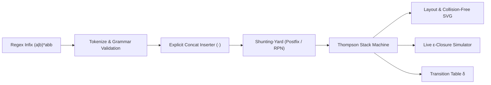

# ⚡ Thompson's Construction Lab — Regex to ε-NFA Interactive Simulator

<div align="center">

[](https://afrojkhan6033.github.io/Regex_To_Epsilon-nfa/Regex_To_Epsilon-nfa.html)
[](test.js)
[-blue?style=for-the-badge&logo=javascript&logoColor=white)](engine.js)
[](#-adaptive-night--dark-modes)
[](LICENSE)

<p align="center">
  <strong>An interactive visualizer, compiler pipeline, and step-by-step stack machine transforming Regular Expressions into Non-deterministic Finite Automata with ε-transitions (ε-NFA).</strong>
</p>

<p align="center">
  <a href="#-core-specialities">Key Highlights</a> •
  <a href="#-adaptive-night--dark-modes">Dark & Light Themes</a> •
  <a href="#-pipeline-architecture">Architecture</a> •
  <a href="#-step-by-step-walkthrough">User Guide</a> •
  <a href="#-developer-extension-guide">Developer Guide</a> •
  <a href="#-creator--connect">Author</a>
</p>

</div>

---

## 🌟 Core Specialities

What sets this project apart from typical regex tools:

- 🚀 **Zero-Build, Pure Vanilla Engineering**: Runs entirely inside the browser with no build steps, bundlers, Babel, Webpack, or npm runtime dependencies. Just open the single HTML file and start exploring.
- 🎬 **Animated Fragment Stack Machine**: Thompson's construction is visualized as a postfix stack machine. Watch sub-automata assemble into complex graphs step-by-step, complete with animated stack pills and applied rule formulas.
- 📐 **Collision-Free Geometry Engine**: Custom mathematical layout algorithm calculates exact spine alignments and clearance offsets ($aboveSpine$, $belowSpine$), preventing curved skip and loop edges from ever intersecting states or nested fragments.
- 🌓 **Adaptive Night / Dark & Light Modes**: Full dual-theme system styled with cohesive design tokens, auto-sensing OS preferences (`prefers-color-scheme`) and supporting instant manual toggling.
- 🔍 **Live String Simulation & Graph Highlighting**: Tests inputs using the formal $\varepsilon$-closure extended transition function ($\hat{\delta}$). Clicking any character or trace row instantly spotlights the active state subset on the canvas.
- 📊 **Complete State Transition Matrix ($\delta$)**: Dynamic transition table generated in real time across the alphabet $\Sigma \cup \{\varepsilon\}$, complete with start ($\to$) and accept ($*$) state markers.
- 📦 **Multi-Format Export Hub**: Instant one-click exports for standalone scalable vector graphics (`.svg`), tabular spreadsheets (`.csv`), formatted Markdown technical reports (`.md`), or direct clipboard copy.
- 🧪 **1,535 Automated Tests**: Exhaustive test suite verifying syntactic error boundaries, Thompson topological invariants, mathematical state bounds, and randomized fuzzing against JavaScript native `RegExp`.

---

## 🌓 Adaptive Night & Dark Modes

Designed with a high-contrast, eye-friendly aesthetic tailored for developers, researchers, and students working late hours:

| Feature | ☀️ Light Mode | 🌙 Night / Dark Mode |
| :--- | :--- | :--- |
| **Canvas Background** | `#F4F6FB` (Crisp paper with subtle dot grid) | `#0A0F1C` (Deep space navy with glowing grid) |
| **Surface Cards** | `#FFFFFF` with soft ambient drop shadows | `#121A2C` with high-contrast borders |
| **Symbol Transitions** | Vibrant Teal (`#0F9B89`) | Neon Aqua (`#4FD7C4`) |
| **ε-Transitions** | Amber Ochre (`#B5700A`) | Vivid Amber (`#F2A857`) |
| **Active States** | Deep Forest Green (`#1E8E5A`) | Bright Emerald (`#6FCF97`) |
| **Accept States** | Berry Crimson (`#C23768`) | Radiant Rose (`#F1729B`) |
| **Auto-Detection** | Triggers automatically via system preference | Triggers automatically via system preference |
| **Manual Override** | Instant toggle via top-right `◐` button | Instant toggle via top-right `◐` button |

> [!TIP]
> Theme settings persist seamlessly across re-renders, window resizes, and simulation runs without losing your zoom level or active state highlights.

---

## 🔬 Formal Theory & Rules Implemented

Thompson's Construction builds an $\varepsilon$-NFA compositionally from regular expressions:



### 1. Thompson Fragment Rules

| Operation | Regex Syntax | Fragment Structure | New States | New Moves |
| :--- | :---: | :--- | :---: | :---: |
| **Base Symbol** | `a` | Two states connected by symbol $a$: $q_i \xrightarrow{a} q_j$ | $2$ | $1$ |
| **Empty String** | `ε` | Two states connected by $\varepsilon$: $q_i \xrightarrow{\varepsilon} q_j$ | $2$ | $1$ |
| **Concatenation** | `RS` | Exit of $R$ connects to Entry of $S$: $f_R \xrightarrow{\varepsilon} s_S$ | $0$ | $1$ |
| **Union (Or)** | `R\|S` | New start splits to $R, S$; exits merge to new final | $2$ | $4$ |
| **Kleene Star** | `R*` | New start/final pair with repeat and bypass edges | $2$ | $4$ |
| **Plus (One+)** | `R+` | Like star, but without the zero-occurrence bypass | $2$ | $3$ |
| **Optional** | `R?` | Like star, but without the repeat loop-back edge | $2$ | $3$ |

### 2. Theoretical Invariants Guaranteed

1. **Exact State Formula**:
   $$|Q| = 2 \times \Big(N_{\text{symbols}} + N_{\text{unions}} + N_{\text{stars}} + N_{\text{pluses}} + N_{\text{optionals}}\Big)$$
2. **Single Entry / Single Exit**: Exactly one start state ($q_{\text{start}}$) and one accept state ($q_{\text{accept}}$).
3. **No Outer Leakage**: $q_{\text{start}}$ has in-degree $0$; $q_{\text{accept}}$ has out-degree $0$.
4. **Bounded Out-Degree**: Every state has an out-degree of at most $2$.

---

## 🕹️ Interactive UI & Step-by-Step Walkthrough

1. **Input & Preset Keypad**:
   - Type any regular expression or click quick-load examples: `(a|b)*abb`, `a(b|c)*d`, `0(0|1)*1`, `ab?c+`, `(a|ε)b*`, `(ab)+|c`.
   - On-screen touch/click keycaps (`|`, `*`, `+`, `?`, `(`, `)`, `ε`, `clear`).
2. **Postfix Pipeline Matrix**:
   - Inspect Dijkstra's Shunting-Yard algorithm output token by token with live operator stack snapshots.
3. **Stepping Controls**:
   - `⏮ First`: Reset to initial token
   - `◀ Prev`: Step one fragment backward
   - `▶ Play / Pause`: Auto-play the assembly animation with smooth transitions
   - `▶ Next`: Advance one fragment forward
   - `⏭ Last`: Jump to the completed automaton
4. **Pan & Zoom Canvas Viewport**:
   - Zoom in (`+`), zoom out (`−`), or fit to frame (`⤢`) with drag-to-pan navigation.
5. **Interactive String Simulator**:
   - Enter test strings (e.g. `abb`) and click **Run**.
   - Inspect step-by-step $\varepsilon$-closures.
   - Click any character in the visual string track to spotlight that exact active state set on the canvas diagram above!

---

## 📁 Repository Structure

```
Regex_To_Epsilon-nfa/
├── Regex_To_Epsilon-nfa.html   # Standalone web app (UI, styles, SVG canvas, dark/light themes)
├── engine.js                   # Pure JavaScript core (Tokenizer, Parser, Thompson, Sim, Tables)
├── test.js                     # 1,535 automated unit tests (Invariants, sizes, RegExp fuzzing)
├── qa.js                       # Headless DOM test runner using JSDOM
├── .gitignore                  # Git exclusions for dependencies and system cache
└── README.md                   # Project documentation
```

---

## 🛠️ Developer Extension Guide

> [!NOTE]
> This section is specifically curated for developers looking to customize, extend, or contribute to this project.

### 1. Running Tests Locally

The core test suite runs under vanilla Node.js without installing any external packages:

```bash
# Run 1,535 pure unit assertions (instant execution)
node test.js
```

To run end-to-end browser QA tests in a headless virtual DOM:

```bash
# Install jsdom (one-time setup for QA)
npm install jsdom

# Run browser simulation tests
node qa.js
```

### 2. How to Add New Regex Operators

The engine in [engine.js](file:///a:/Projects/regex_simulator/engine.js) is cleanly decoupled into 6 distinct phases:

1. **Tokenizer (`tokenize`)**:
   - Add new token types (e.g. character classes `[a-z]`, wildcards `.`, or count ranges `{n,m}`) to the character scanner.
2. **Validator (`validate`)**:
   - Extend the recursive-descent grammar rules (`parseAtom`, `parseRepeat`, `parseConcat`, `parseUnion`).
3. **Implicit Concat Inserter (`insertConcat`)**:
   - Define whether the new operator can start an atom (`startsAtom`) or end an atom (`endsAtom`).
4. **Shunting-Yard (`toPostfix`)**:
   - Assign appropriate precedence in `PRECEDENCE` and register in `UNARY` or `BINARY` sets.
5. **Thompson Construction (`buildNFA`)**:
   - Implement your layout constructor (`buildYourOperator(A, B)`) returning:
     ```javascript
     {
       stateIds: [...],
       edges: [...],
       entryId: s,
       exitId: f,
       extraTop: ...,
       extraBottom: ...
     }
     ```
6. **Simulator & Invariant Tests**:
   - Add verification cases in `test.js` to ensure max out-degree $\le 2$ and exact state count guarantees.

### 3. Deploying to GitHub Pages (Live in 30 Seconds)

To host your own live web demo directly on GitHub:

1. Push your repository to GitHub.
2. Go to your repository **Settings** $\to$ **Pages**.
3. Under **Branch**, select `main` and root `/` folder, then click **Save**.
4. Access your live app at:
   `https://<your-username>.github.io/Regex_To_Epsilon-nfa/Regex_To_Epsilon-nfa.html`

---

## 👨‍💻 Creator & Connect

<div align="center">

### Built with care by **Afroj Khan**

[](https://github.com/afrojkhan6033)
[](https://github.com/afrojkhan6033)

<p align="center">
  Passionate about computer science education, compiler construction, and building intuitive developer tools.
</p>

<p align="center">
  ⭐ <strong>If you found this project helpful or educational, please consider giving it a Star!</strong> ⭐<br>
  Follow on GitHub for upcoming interactive simulators, algorithms visualizers, and open-source releases.
</p>

</div>

---

## 📄 License

This repository is licensed under the [MIT License](LICENSE) — free for educational, academic, and open-source use.
